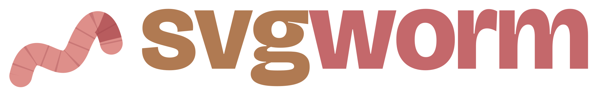
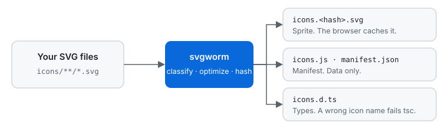

<div align="center">

<h1>
  <picture>
    <source media="(prefers-color-scheme: dark)" srcset="docs/assets/logo-dark.svg">
    <source media="(prefers-color-scheme: light)" srcset="docs/assets/logo-light.svg">
    
  </picture>
</h1>

**Turn a folder of SVG files into type-safe, cacheable SVG sprites.**<br>
Zero client JavaScript, deterministic output, and adapters for Next.js Server Components and Astro.

[](https://www.npmjs.com/package/svgworm)
[](https://www.npmjs.com/package/@svgworm/react)
[](https://github.com/jmlweb/svgworm/actions/workflows/ci.yml)
[](LICENSE)

**[svgworm.com](https://svgworm.com)**



</div>

```tsx
const home = <Icon name="home" />; // <svg><use href="/icons/icons.f84bac71.svg#i-home"/></svg>
const nope = <Icon name="nope" />; // type error: "nope" is not an icon name
```

## Why

- **Icons that render right, with no config.** Each icon is mono (follows `currentColor`) or multicolor (keeps its colors). Gradients, masks and filters render in Chromium, Firefox and WebKit.
- **Zero client JS.** The browser fetches one hashed sprite and caches it.
- **Type-safe names.** A wrong icon name fails `tsc`.
- **No bundler plugin.** It is a CLI that writes files, so it works with Turbopack, webpack and Vite.
- **Deterministic.** The same input gives byte-identical output on every OS.

## Get started

Requires Node `^22.20 || >=24.11`. The example uses Next.js App Router.

**1. Install and set up**

```bash
pnpm add -D svgworm
pnpm add @svgworm/react
pnpm svgworm init
```

`init` asks a few questions (or takes `--yes`), writes `svgworm.config.json`, adds `predev` and `prebuild` scripts, and creates `components/icon.tsx`.

**2. Add your icons and build**

Put SVG files in `icons/` and run `pnpm svgworm`. The build prints what it did:

```text
svgworm: build done
  icons     8 (5 mono, 3 multicolor)
  delivery  use 6, img 2, mask 0
  output    3.5 KiB (sprite 2.2 KiB, stack 1.3 KiB)
  time      15 ms
```

**3. Use the component in any Server Component**

```tsx
import { Icon } from '@/components/icon';

export const Nav = () => (
  <nav>
    <Icon name="home" />
    <Icon name="home" title="Go home" width={32} height={32} />
  </nav>
);
```

> [!TIP]
> The icon is `aria-hidden` unless you pass `title` or `label`.

Also works with Astro: `svgworm init` detects it and writes a React-free `Icon.astro`, see the [Astro guide](https://svgworm.com/docs/astro/). Doing it by hand, long-term caching, and `basePath` are in the [Next.js guide](https://svgworm.com/docs/nextjs/). A complete app, built with Turbopack and checked for zero client JS in CI, is in [examples/next-app-router](examples/next-app-router).

## How it compares

| If you...                                                      | Use                                                                                          |
| -------------------------------------------------------------- | -------------------------------------------------------------------------------------------- |
| Have your own icon folder in a Next.js App Router app          | **svgworm**                                                                                  |
| Want one tree-shaken component per icon and accept the JS cost | [SVGR](https://github.com/gregberge/svgr)                                                    |
| Need several sprites or a webpack/Vite plugin today            | [@neodx/svg](https://neodx.pages.dev/svg/)                                                   |
| Use Vite and all your icons are single-color                   | [vite-plugin-icons-spritesheet](https://github.com/forge42dev/vite-plugin-icons-spritesheet) |

The full [comparison](https://svgworm.com/docs/comparison/) has spike numbers and says where each tool is the better choice.

## Docs

- [Next.js guide](https://svgworm.com/docs/nextjs/): manual setup, caching for a year, `basePath`
- [Astro guide](https://svgworm.com/docs/astro/): the generated `Icon.astro`, caching, `base`
- ⌨️ [CLI](https://svgworm.com/docs/cli/): commands, flags, exit codes, `check` in CI, `watch`
- [Config](https://svgworm.com/docs/config/): `svgworm.config.json` and its [JSON Schema](packages/svgworm/svgworm.schema.json)
- [Output contract](docs/output-contract.md): exact shape of the generated files
- [Comparison](https://svgworm.com/docs/comparison/): SVGR, @neodx/svg and others, with the numbers behind each claim

## For AI agents

Read [llms.txt](llms.txt). Everything is non-interactive: flags, `--json`, stable exit codes, and a JSON Schema for the config. The agent skill walks an agent through setting svgworm up in a Next.js app and fixing each error code:

```bash
npx skills add jmlweb/svgworm --skill svgworm-nextjs
```

For an Astro site, use `--skill svgworm-astro`.

## Status

> [!NOTE]
> 0.x, on npm since 2026-10-13. Before 1.0 the output contract and flags can still change in a minor version; each change is in the [changelog](packages/svgworm/CHANGELOG.md).

## Contributing

Issues and pull requests are welcome. Start with [CONTRIBUTING.md](CONTRIBUTING.md) and [AGENTS.md](AGENTS.md). Background lives in [docs/vision.md](docs/vision.md) and the [ADRs](docs/adr/).

## License

[MIT](LICENSE)
